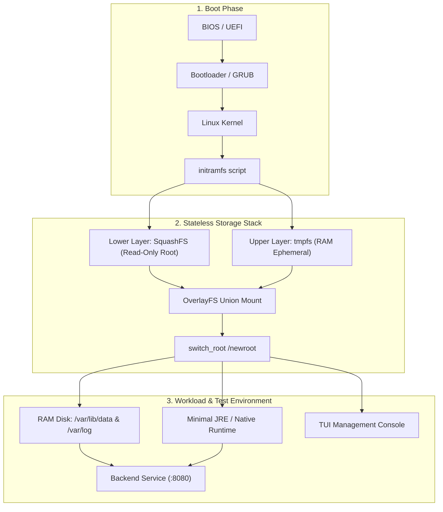

# PhantomOS 🐧⚡

> A minimal, stateless Linux distribution optimized for backend performance & load testing.

[]()
[]()
[](LICENSE)

---

## 📌 Overview

**PhantomOS** is an ultra-lightweight, stateless micro-distribution built on top of the Linux Kernel and BusyBox/Buildroot. It is engineered specifically to provide an isolated, deterministic, and high-performance execution environment for backend applications (Java / Spring Boot, Go, Node.js).

### ✨ Key Features
- **Stateless by Design (OverlayFS):** The root filesystem is locked as Read-Only (SquashFS). All runtime state changes are held in ephemeral RAM layers and discarded upon reboot.
- **In-Memory Database & Logging (RAM Disk):** Critical paths such as `/var/lib/data` and `/var/log` are mounted directly on `tmpfs`, eliminating disk I/O bottlenecks during stress testing.
- **Trimmed Runtime Footprint:** Stripped Java Runtime Environment (JRE) via `jlink` (~40MB) and essential networking toolchains (`curl`, `iproute2`, `htop`).
- **Sub-Second Boot:** Cold-boots in under 2 seconds with an idle memory footprint of **under 60MB RAM**.

---

## 🏗️ System Architecture



---

## 📂 Repository Structure

```text
PhantomOS/
├── apps/                 # Native GTK2/Cairo desktop apps (phantom-login, phantom-monitor)
├── configs/              # Buildroot, Kernel, users-table & permission configs
├── overlayfs/            # Initramfs and stateless OverlayFS mount logic
├── patches/              # Buildroot host compatibility patches
├── rootfs-overlay/       # Target filesystem overlay (init scripts, Fluxbox, skel, sudoers)
│   ├── etc/init.d/       # Init scripts (Xorg, Display Manager, RAM disk, network)
│   └── opt/tui-menu/     # Terminal UI control dashboard
├── backend-sample/       # Sample RESTful backend application for load testing
├── benchmarks/           # Load testing scripts (k6, wrk) and metric collectors
├── scripts/              # Build, rootfs update, QEMU runner & stateless smoke tests
└── docs/                 # Architecture notes and benchmarking reports
```

---

## 🚀 Getting Started

### Prerequisites (Host Machine)
Ensure the following packages are installed on your host system:
* **Arch Linux:** `sudo pacman -S --needed base-devel git bc rsync ncurses qemu-system-x86`
* **Ubuntu/Debian:** `sudo apt install build-essential git bc rsync libncurses-dev qemu-system-x86`

### Build PhantomOS
```bash
# Clone the repository
git clone https://github.com/<username>/PhantomOS.git
cd PhantomOS

# Run the automated build script
./scripts/build-os.sh
```

### Run on QEMU
```bash
# Full Desktop GUI (Display Manager + Fluxbox + VirtIO GPU)
./scripts/run-qemu.sh

# Headless CLI profile (~22MB RAM idle, ~1.2s boot)
./scripts/run-qemu.sh --headless

# Automated stateless & sudo verification suite
./scripts/test-stateless.sh
```
* **Standard User (`sudo`):** `phantom` / password `phantom`
* **Administrator:** `root` / password `root`
* **Port Forwarding:** Host `localhost:8080` forwarded to VM `8080`

---

## 📄 License
This project is open-source under the [MIT License](LICENSE).
